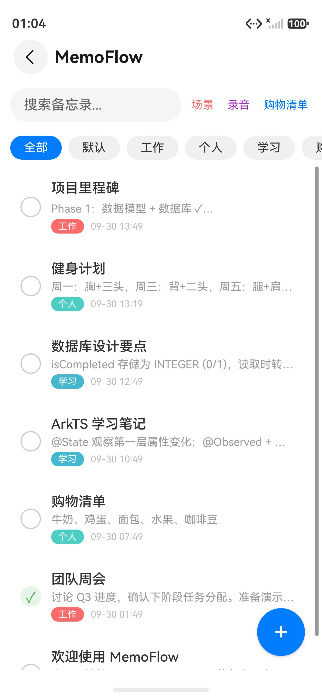
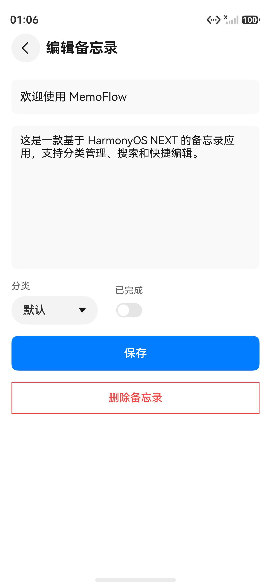
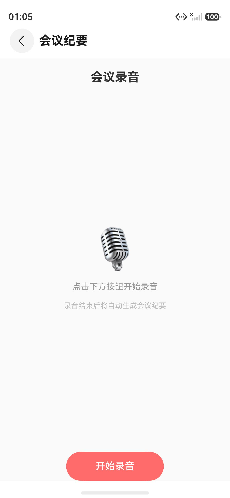
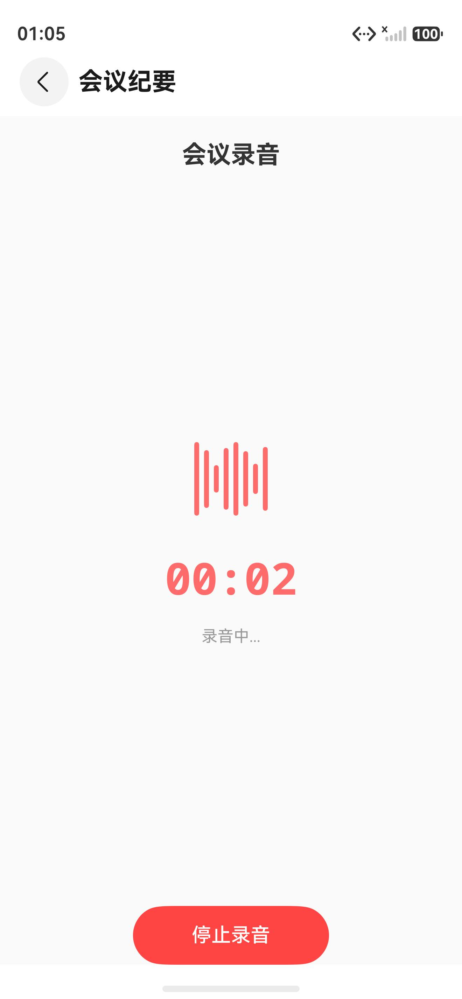
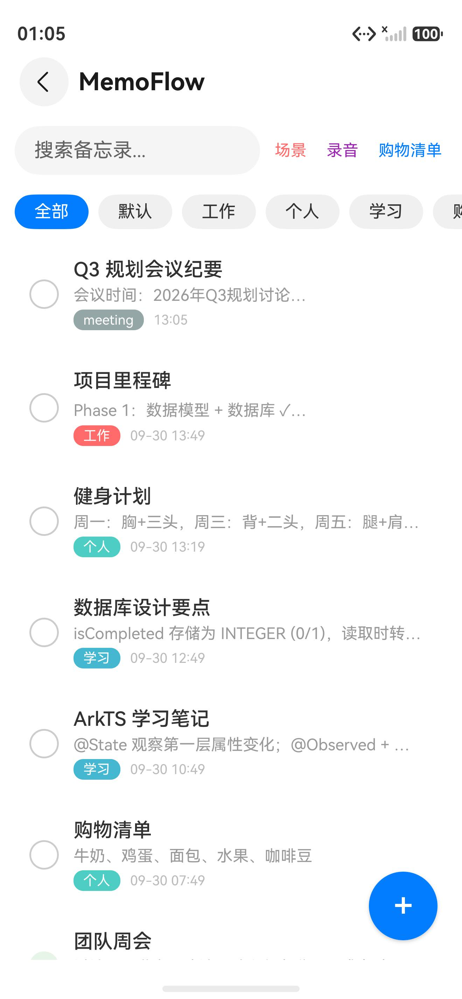
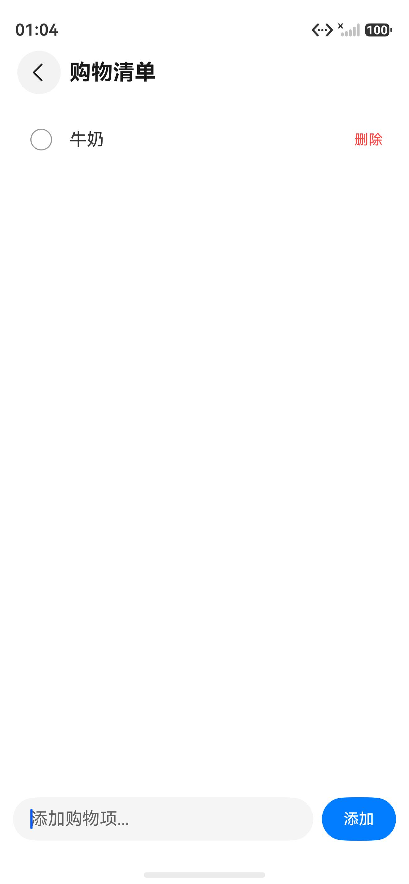
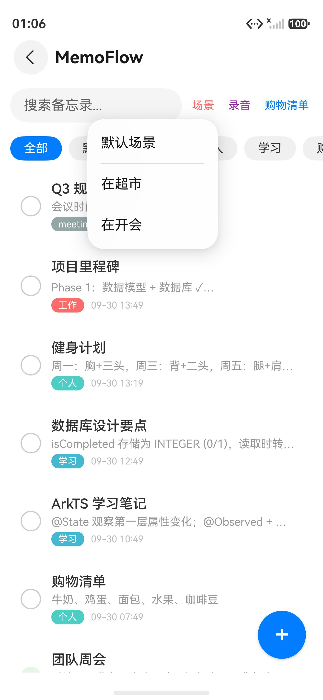
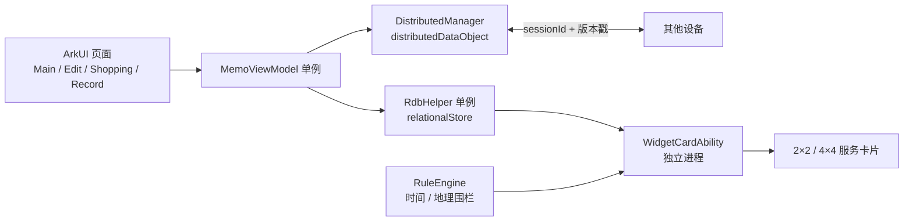

# MemoFlow

> 基于 HarmonyOS NEXT 的分布式协同备忘录。  
> ArkTS / ArkUI · API 24 · RelationalStore · Distributed Data Object · Form Kit


MemoFlow 不只是一个本地备忘录。它把「多设备之间怎么接上」作为核心问题：手机上写到一半，平板可以继续；购物清单在多端实时同步；会议纪要生成后可以推到其他设备；桌面服务卡片会按时间和位置场景主动刷新。

## 截图

| 主列表 | 编辑备忘录 |
| --- | --- |
|  |  |

| 会议录音 | 录音中 |
| --- | --- |
|  |  |

| 会议纪要生成 | 购物清单 |
| --- | --- |
|  |  |

| 场景切换 |
| --- |
|  |

## 核心能力

- **本地备忘录**：增删改查、分类筛选、防抖搜索，列表使用 `LazyForEach` 按需渲染。
- **分布式协同编辑**：确定性 `sessionId` 组网，逻辑时钟版本戳做回声过滤，LWW 自动裁决，冲突窗口内由用户仲裁。
- **三类跨设备场景**：编辑接续（`onContinue`）、购物清单实时同步、会议纪要跨设备推送。
- **桌面服务卡片**：2×2 / 4×4 卡片，独立进程直接查 RDB，扁平化数据经 `FormBindingData` 传递。
- **场景感知**：时间规则 + 地理围栏规则 + 观察者模式，场景变化时主动刷新卡片。
- **会议纪要链路**：录音 → 纪要生成 → 入库 → 分布式推送 → 对端通知。

> 诚实边界：当前版本的「录音转写」是录音计时 + 模板纪要模拟，不是真实 ASR。架构上可在该节点替换为语音识别或大模型接口。

## 技术架构



分层职责：

| 层 | 职责 |
| --- | --- |
| UI | ArkUI 声明式页面、`@State` / `@Consume` 状态、`Navigation` 路由 |
| ViewModel | 业务编排、搜索防抖、列表数据源、分布式事件回调 |
| RDB | `relationalStore` 增删改查、分类索引、版本升级 |
| Distributed | 编辑接续、购物清单、会议纪要三类同步会话 |
| Widget | 卡片独立进程、RDB 直查、扁平化数据、场景刷新 |

## 技术亮点

### 1. 协同编辑的冲突解决

多端同时编辑不能只靠「后写覆盖先写」。项目把冲突处理拆成四步：

1. **确定性组网**：各端使用相同 `sessionId` 加入同一分布式会话。
2. **版本戳**：每次写入以 `Date.now()` 作为 `updateTime`，用逻辑时钟比较新旧。
3. **回声过滤**：本地写入触发的 `change` 事件不重复应用到本地，避免自激循环。
4. **冲突仲裁**：冲突窗口内两端都发生修改时弹窗让用户选择；窗口外按 LWW 自动裁决。

### 2. 服务卡片为什么不能复用 ViewModel

`FormExtensionAbility` 运行在独立进程，与主应用不共享对象实例。卡片进程不能 import 主应用 ViewModel，因此卡片直接查询同一沙箱内的 RDB，并把数据扁平化为基本类型后通过 `FormBindingData` 传递；卡片 UI 只使用 `@LocalStorageProp` 接收数据。

### 3. 场景规则引擎

`RuleEngine` 用时间规则（9:00–10:00 会议）和地理围栏（超市 200 米内）评估当前场景，通过观察者模式通知卡片刷新。开发者面板可以手动切换模拟场景，便于在模拟器上演示。

### 4. 数据层

- 单例 `RdbHelper` 统一管理数据库生命周期。
- `store.version` 做增量升级，`CREATE INDEX IF NOT EXISTS` 保证幂等。
- 搜索与分类查询使用参数化 SQL / `RdbPredicates`，不拼接用户输入。

## 工程化

```powershell
# 编译并生成签名 HAP
devecocli build
```

当前验证结果：

| 项 | 结果 |
| --- | --- |
| SDK | HarmonyOS SDK 6.1.1 / API 24 |
| 编译 | `BUILD SUCCESSFUL`，ArkTS 警告 0 |
| 产物 | `entry/build/default/outputs/default/entry-default-signed.hap` |
| 源码规模 | 16 个 `.ets` 文件，约 3,739 行 |

## 目录结构

```text
entry/src/main/ets/
├── model.ets                 # Memo 数据模型
├── database.ets              # RdbHelper，关系型数据库
├── viewmodel.ets             # MemoViewModel，业务逻辑
├── common.ets                # 路由、分类、LazyForEach 数据源、时间格式化
├── entryability/             # EntryAbility，接续恢复入口
├── pages/                    # 主列表 / 编辑 / 录音 / 购物清单
├── distributed/              # 分布式协同编辑与同步
├── rules/                    # 场景感知规则引擎
└── widget/                   # 服务卡片 UI、FormExtensionAbility、数据构建
```

## 运行

1. 使用 DevEco Studio 打开项目根目录。
2. 选择 HarmonyOS NEXT API 24 模拟器或真机。
3. 执行 `devecocli build`，或直接在 DevEco Studio 中 Run。
4. 首次运行会在本地创建 `MemoStore.db` 并写入示例备忘录。

分布式能力需要两台设备登录同一华为账号，并授予分布式数据同步权限；单机演示可使用「场景」菜单模拟场景切换。

## 面试材料

- 简历项目描述、3 分钟讲解、鸿蒙面试问答：见 [项目讲解文档.md](项目讲解文档.md)。
- 截图素材：`docs/screenshots/`。

